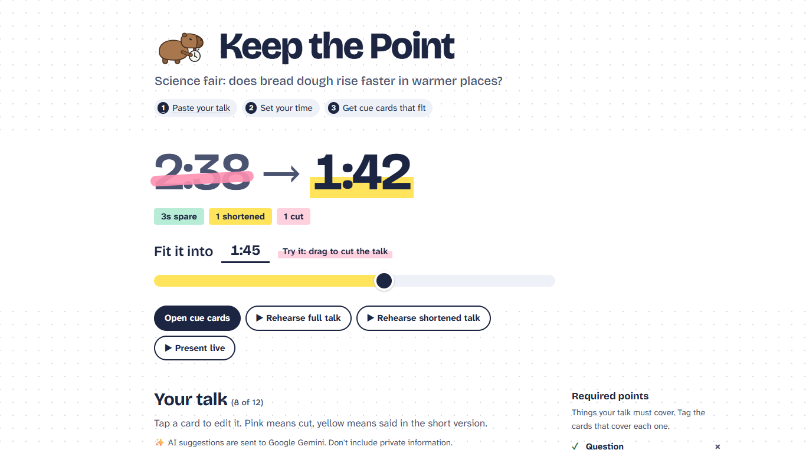
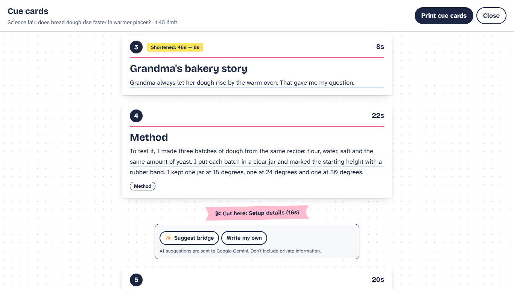
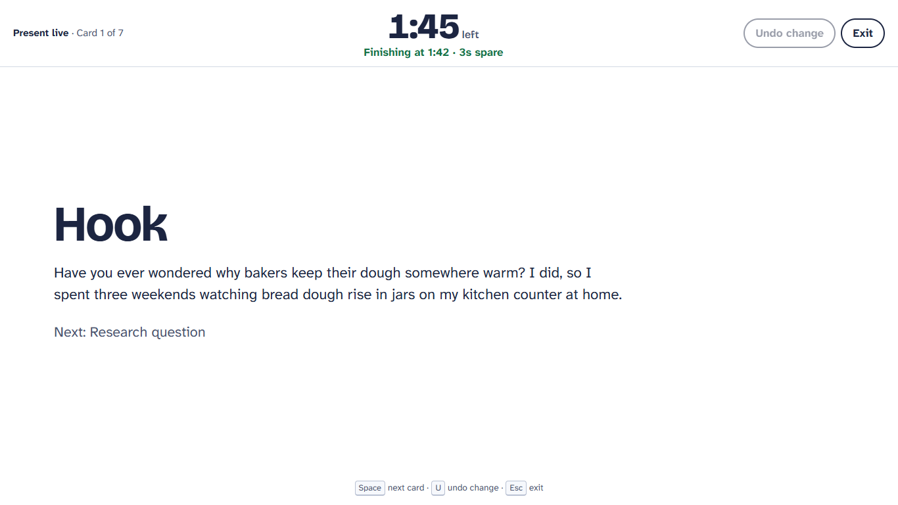

# Keep the Point

Keep the Point helps students fit a presentation into a time limit while covering every required point. Built for Teens Hack Houston 2026 (productivity theme). [Try it live](https://keep-the-point.vercel.app/)

## Try it in 30 seconds

1. Drag the time slider on the sample science-fair talk and watch which cards get shortened or cut.
2. Click **Open cue cards** to see what you'll say and where the cuts land.
3. Close the cue cards and click **Present live**. Press Space to start the clock, then press it again to advance to the next card.

## Features

- **Fit to time.** Set a time limit and get cue cards that keep required points and locked cards whenever a valid plan fits.
- **Smart setup.** Paste a script and rubric to get a suggested breakdown into cards and required points.
- **AI shorten and bridge lines.** Ask for a shorter version of a card or a line that connects the cards around a cut. Review each suggestion before using it.
- **Live pacing.** See your time left, the projected finish, and updates to your remaining cards as you speak.
- **Practice insights.** Compare recent rehearsals and spot cards that keep running long.
- **Group presentations.** Open Group presentation under Your talk, enable speaker assignments, and enter a name for each card. See planned time by speaker and carry those names into cue cards and print. Rehearsal and Present live use the team's shared clock. At a handoff, advance once to start the transition and again when the next speaker is ready. The summary shows speaking times and handoffs separately.

## How it works

The app runs an exact search over full, short, and cut options for every card, honoring locks and required points and picking the highest-priority plan that fits. AI only offers suggestions and never rewrites your original words. Smart setup rebuilds the cards from the original sentences. Live pacing only cuts or shortens upcoming cards when you're behind and only adds material back when you're at least 8 seconds ahead. It never swaps one card for another.

## Tech stack and privacy

Vite and TypeScript power the app, Vercel Functions serve AI requests, and Vitest runs the automated tests. Talks and practice history are saved in your browser. When you use an AI feature, the text needed for that request is sent to Google Gemini.

**Run locally.** Use `npm install`, optionally set `GEMINI_API_KEY=your-key` in `.env.local` for AI features, then run `npm run dev`.

## Screenshots

**Default sample at 1:45**



**Cue cards**



**Present live**



## Running it

```
npm install
npm run dev     # opens the app at http://localhost:5173
npm test        # runs the tests
```

## AI suggestions (optional)

The app works fully without AI. With a Google Gemini API key, two extra buttons can suggest wording:

- **✨ Shorten** on each card asks for a short version (about half the time) that keeps your voice and every fact. You can accept, edit or discard it, or write your own.
- **✨ Suggest bridge** on each ✂ cut marker in the cue cards asks for one linking sentence (max 15 words).

The key stays on the server (`api/shorten.ts`, `api/bridge.ts`, Vercel functions). For local use, put it in `.env.local` (gitignored):

```
GEMINI_API_KEY=your-key
```

On Vercel, add `GEMINI_API_KEY` under Project → Settings → Environment Variables. `npm run build` checks that no key ended up in `dist/`. AI suggestions are sent to Google Gemini, so don't include private information.

## How the selection works

Each card has a spoken length in seconds. Some cards cover a **required point** (like "Evidence"). Some are **optional** and have a priority from 1 (nice to have) to 5 (really want it). Any card can be **locked**, meaning "never cut this".

To fit your time limit, the app:

1. **Keeps every locked card, in full.**
2. **Tries every possible mix of the other cards.** Each card can be said in full, said as its **short version** (if it has one), or cut. With 12 cards at most, that's at most 3^12 = 531,441 mixes, so it can check all of them rather than guessing. A short version counts for 60% of the card's priority, and keeps the card's required-point tags.
3. **Throws out any mix that runs over time** or that drops a required point (no card left that covers it).
4. **Picks the mix with the most total priority.** If two mixes tie, it takes the one that uses more of your time.
5. **Shows the result in your original order.** Cut cards say why they went, e.g. "Optional, priority 1 — saves 46s".

If nothing fits, it says so and shows the **shortest talk that still covers every required point** (plus your locked cards), so you know how much time you'd need or what else to trim.
